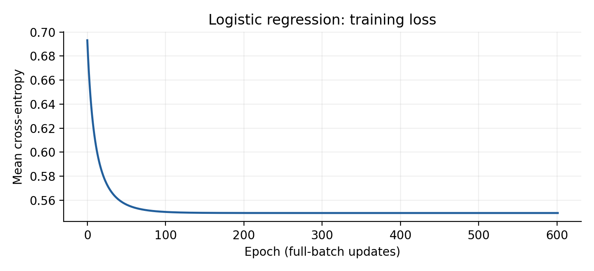
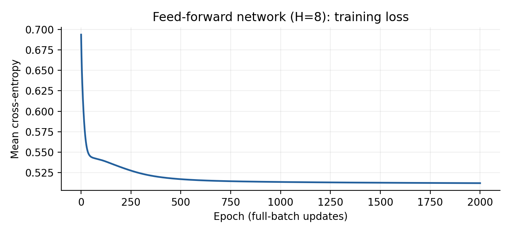

# Project 1: Logistic Regression and Feed-Forward Neural Network

**Author: Albert Kabore**

## 1. Aim and main findings

The task is to learn weights W and bias B that predict positive or negative sentiment from exactly six specified text features. Here, lowercase w and b denote those same parameters. Logistic regression and a feed-forward network are implemented in NumPy, trained on labelled IMDB reviews, and evaluated on held-out reviews. All reported scores and worked-example calculations come from `train.py` and `results/results.json`.

Logistic regression achieved **73.57%** test accuracy; the selected network achieved **74.70%**. The baseline, predicting the training set's majority label for every test review, achieved **50.19%**. These are results for this dataset and split, not universal performance guarantees.

## 2. Dataset, provenance and evaluation design

The input is [IMDB Dataset of 50K Movie Reviews, published by Lakshmipathi N on Kaggle](https://www.kaggle.com/datasets/lakshmi25npathi/imdb-dataset-of-50k-movie-reviews), associated with the Large Movie Review Dataset of [Maas et al. (2011)](https://aclanthology.org/P11-1015/). The supplied CSV contains 50,000 rows: 25,000 positive and 25,000 negative, with no missing review texts or labels. Labels are encoded as positive = 1 and negative = 0. Review texts and labels are used as supplied; no reviews or labels are generated for training or evaluation. Published labels are not independently re-annotated in this project.

The input file is `data/IMDB Dataset.csv`. Its SHA-256 is:

```text
dfc447764f82be365fa9c2beef4e8df89d3919e3da95f5088004797d79695aa2
```

The local file matches the copy in the Kagglehub dataset-version-1 cache. The downloader uses the official `kagglehub` client if the local CSV is absent. The checksum identifies the exact file used; the code does not infer authenticity solely from a filename.

**Duplicate handling.** There are 418 excess exact duplicate rows. Removing HTML tags, lowercasing, and collapsing whitespace identifies 4 further excess duplicate texts. Removing all 422 duplicates before splitting leaves **49,578 reviews**; retained class counts are `{'positive': 24882, 'negative': 24696}`. The loader rejects missing texts, unknown labels, and conflicting labels on equivalent texts. It preserves the original CSV row number for each retained review. The raw CSV is not modified.

**Splitting.** Seed 42 produces a stratified 70% / 15% / 15% split, with integer sizes rounded within each class:

| Part | Reviews | Positive | Purpose |
| --- | --- | --- | --- |
| train | 34,704 | 50.19% | Fit weights |
| validation | 7,438 | 50.19% | Choose hidden width |
| test | 7,436 | 50.19% | Evaluate fixed models |

All three pairs of splits have zero overlap under the normalized-text rule. This checks exact and formatting duplicates; it does not establish the absence of paraphrases, shared movies or authors. This CSV experiment uses a new random split, rather than Stanford's official benchmark split, so the scores should not be compared directly with its published benchmark scores.

Only training reviews determine scaling statistics and parameter updates. The neural-network width is selected by validation cross-entropy, then the fixed models are evaluated on test reviews. This submission recomputes results after correcting duplicate handling in an earlier evaluated version; it does not claim the test set has never been inspected. Subsequent feature or model development should use validation data and obtain fresh test data for a new confirmation.

## 3. The six required features

| Symbol | Feature | Exact implementation |
| --- | --- | --- |
| x1 | Positive lexicon words | Count every token occurrence in the positive word set |
| x2 | Negative lexicon words | Count every token occurrence in the negative word set |
| x3 | Contains no | 1 when the whole lowercase token `no` occurs, otherwise 0 |
| x4 | First- and second-person pronouns | Count exact tokens from the pronoun list below |
| x5 | Contains ! | 1 when `!` appears in text after HTML removal, otherwise 0 |
| x6 | Log word count | Natural logarithm of token count, with the empty-text convention below |

The opinion word lists are the Hu and Liu lexicon distributed by NLTK: 2,006 positive and 4,783 negative entries. Tokens use `[a-z0-9]+(?:[-'][a-z0-9]+)*` after HTML removal and lowercasing. Hyphenated words and apostrophe contractions remain single tokens. There is no stemming or learned vocabulary. Thus `no` differs from `know`, `nothing`, and `no-good`. Each repeated occurrence counts again.

The pronoun list is `i me my mine myself we us our ours ourselves you your yours yourself yourselves`. Matching is exact: a contraction such as `I'm` is one token and is not counted as standalone `I`. This explicit convention makes the feature reproducible. A different contraction policy would require retraining and reporting new weights.

For an empty document, x6 is defined as ln(max(token count, 1)) = 0 to avoid ln(0). For every nonempty review, it is exactly ln(token count). No seventh feature is added.

Descriptive means across the retained corpus (not used to fit scaling):

| Feature | Negative mean | Positive mean |
| --- | --- | --- |
| Positive words | 8.1860 | 11.6628 |
| Negative words | 11.2445 | 7.5841 |
| Contains no | 0.3886 | 0.2515 |
| Pronouns | 6.3789 | 6.0229 |
| Contains ! | 0.3549 | 0.3390 |
| ln(word count) | 5.2265 | 5.2188 |

Training uses standardized features:

$$\tilde{x}_j = \frac{x_j-\mu_j}{s_j}$$

Here mu is the training mean and s is the training population standard deviation, calculated with `ddof=0`. A zero standard deviation is replaced by 1 to prevent division by zero; that feature is then zero on training data. Scaling can improve numerical conditioning. With unregularized logistic regression, an invertible scaling preserves the set of possible fitted logits.

| Statistic | x1 | x2 | x3 | x4 | x5 | x6 |
| --- | --- | --- | --- | --- | --- | --- |
| Training mean | 9.93508 | 9.42868 | 0.31959 | 6.18969 | 0.34691 | 5.22302 |
| Training std | 7.76164 | 8.50226 | 0.46632 | 5.71426 | 0.47599 | 0.64395 |

## 4. Logistic regression: equations and notation

The formulation follows the logistic-regression chapter of [Jurafsky and Martin (2026)](https://web.stanford.edu/~jurafsky/slp3/4.pdf).

| Symbol | Plain-English meaning |
| --- | --- |
| m | Number of training reviews: 34,704 |
| i, j | Review index and feature index; j runs from 1 to 6 |
| x, tilde x | Raw six-feature vector and its standardized version |
| y | Supplied target label: positive = 1, negative = 0 |
| w, b | Six learned coefficients and one learned bias |
| z | Weighted score, also called the logit |
| sigma | Logistic sigmoid function |
| p | Model-estimated probability of the positive class |
| L | Average training cross-entropy loss |
| eta | Learning rate, 0.5 in this experiment |
| gradient | Vector of partial derivatives, indicating how loss changes with each parameter |

### 4.1 Prediction and objective

$$z^{(i)} = \sum_{j=1}^{6}w_j\tilde{x}^{(i)}_j+b$$

$$p^{(i)} = \sigma(z^{(i)}) = \frac{1}{1+e^{-z^{(i)}}}$$

Predict positive when p is at least 0.5, otherwise negative. The sigmoid gives a model probability estimate; calibration is not established by using a sigmoid alone.

For one review:

$$\ell(p,y) = -y\ln(p)-(1-y)\ln(1-p)$$

The desired parameters minimize the mean training loss:

$$L(w,b) = \frac{1}{m}\sum_{i=1}^{m}\ell(p^{(i)},y^{(i)})$$

The best weights mean a numerical approximation to this training-loss minimizer. They do not mean weights that maximize test accuracy. No L2 penalty is used in the reported experiment.

### 4.2 Derivatives and parameter updates

Combining the sigmoid derivative with cross-entropy gives:

$$\frac{\partial\ell}{\partial z}=p-y$$

$$\frac{\partial L}{\partial w_j}=\frac{1}{m}\sum_{i=1}^{m}(p^{(i)}-y^{(i)})\tilde{x}^{(i)}_j$$

$$\frac{\partial L}{\partial b}=\frac{1}{m}\sum_{i=1}^{m}(p^{(i)}-y^{(i)})$$

For the m-by-6 standardized training matrix Z, predictions p and labels y are length-m vectors:

$$g_w=Z^T(p-y)/m$$

$$w\leftarrow w-\eta g_w,\qquad b\leftarrow b-\eta g_b$$

Initialize all seven parameters to zero. Stop when the joint gradient norm is below 0.000001, with a maximum of 100,000 updates. The stopping condition is checked before each update. The program asserts that the requested tolerance was reached.

### 4.3 Why the optimization is justified

For the augmented design A = [Z, 1], the Hessian is:

$$\nabla^2 L=A^TDA/m,\qquad D_{ii}=p^{(i)}(1-p^{(i)})$$

This matrix is positive semidefinite, so the objective is convex. Full column rank of A gives strict convexity at finite parameter values. A finite unregularized optimum also requires the absence of complete or quasi separation; convexity alone does not guarantee a finite or unique solution. These distinctions follow the convex-optimization framework of Boyd and Vandenberghe (2004).

Here A has measured rank **7 of 7**. Newton's method yields a finite numerical solution whose Hessian has minimum eigenvalue **0.031718** and gradient norm **1.547e-17**. Gradient descent agrees within **1.969e-05** in maximum absolute parameter difference. These are numerical checks supporting a well-resolved solution, not a symbolic proof of exact coefficients.

Because each diagonal entry of D is at most 1/4, one upper bound on the gradient's Lipschitz constant is one quarter of the largest eigenvalue of A-transpose A divided by m. The measured bound is **0.705880**. The learning rate 0.5 is below its reciprocal **1.416670**, giving a sufficient descent step size. The saved training loss is also checked to be nonincreasing.

## 5. Learned logistic weights and bias

Training required **601 full-batch updates**. Final mean loss is **0.54937912**, compared with ln(2) = 0.693147 at initialization; the final joint gradient norm is **9.862e-07**.

| Parameter | Feature | Standardized | Raw scale |
| --- | --- | --- | --- |
| w1 | Positive words | 1.599462 | 0.206073 |
| w2 | Negative words | -1.464636 | -0.172264 |
| w3 | Contains no | -0.272841 | -0.585097 |
| w4 | Pronouns | -0.152887 | -0.026755 |
| w5 | Contains ! | -0.016226 | -0.034090 |
| w6 | ln(word count) | 0.050160 | 0.077894 |
| b | Bias | 0.019243 | -0.446299 |

The equivalent raw-scale weights are **(0.206073, -0.172264, -0.585097, -0.026755, -0.034090, 0.077894)**, with bias **-0.446299**. Full-precision parameters are saved in the JSON. The conversion is:

$$w^{raw}_j=w_j/s_j$$

$$b^{raw}=b-\sum_{j=1}^{6}w_j\mu_j/s_j$$

This follows by expanding the standardized weighted sum. The program verifies that raw and standardized predictions agree numerically. Holding the other features fixed, increasing one raw feature by one unit multiplies predicted positive odds by exp(its raw weight). This conditional association is not a causal effect. The two lexicon counts have the largest absolute standardized coefficients in this fit; small coefficients do not prove a feature is useless in every model.



## 6. Feed-forward neural network

### 6.1 Forward propagation and symbols

The architecture is 6 standardized inputs, H tanh hidden units, and one sigmoid output. W1 is an H-by-6 matrix, b1 is a length-H bias vector, h is a length-H activation vector, w2 is a length-H output-weight vector, and b2 is the scalar output bias. Superscript T denotes transpose.

$$h=\tanh(W_1\tilde{x}+b_1)$$

$$z=w_2^Th+b_2,\qquad p=\sigma(z)$$

The objective is the same average cross-entropy. For a single example, the chain rule gives the following derivatives; batch gradients average these values across training reviews. The symbol odot means element-by-element multiplication.

$$\delta_o=p-y,\qquad g_{w_2}=\delta_o h,\qquad g_{b_2}=\delta_o$$

$$\delta_h=(\delta_o w_2)\odot(1-h^2)$$

$$g_{W_1}=\delta_h\tilde{x}^T,\qquad g_{b_1}=\delta_h$$

Every parameter is updated by subtracting eta times its batch gradient. All gradients are calculated from the same pre-update parameters. The derivative of tanh is 1 minus h squared. See [Goodfellow, Bengio and Courville (2016), Chapter 6](https://www.deeplearningbook.org/contents/mlp.html) for feed-forward networks and backpropagation.

Weights use Gaussian initialization with mean zero and variance 1/fan-in: 1/6 for W1 and 1/H for w2, with zero biases and random seed 42. This is the implemented fan-in rule; it is not labelled as exact Xavier/Glorot initialization. Random hidden weights break the symmetry that would make identical hidden units learn identical functions.

### 6.2 Model selection and learned parameters

Each width is trained for 2,000 full-batch epochs, learning rate 0.5, without regularization or early stopping:

| Hidden units | Train loss | Validation loss | Train accuracy | Validation accuracy |
| --- | --- | --- | --- | --- |
| 2 | 0.517461 | 0.512832 | 74.29% | 74.74% |
| 4 | 0.514072 | 0.508573 | 74.53% | 74.48% |
| 8 | 0.512092 | 0.506832 | 74.50% | 74.85% |

**H = 8** has the lowest validation loss and is selected. This network has **65 parameters**, compared with seven for logistic regression. Its objective is nonconvex, so these are the parameters obtained from this seed and search, with no claim of a global optimum.

The selected parameters are rounded below; `results/results.json` stores full precision. W1:j is the weight from input j into that hidden unit.

| Unit | W1:1 | W1:2 | W1:3 | W1:4 | W1:5 | W1:6 | b1 | w2 |
| --- | --- | --- | --- | --- | --- | --- | --- | --- |
| 1 | 0.3856 | -1.0123 | 0.0029 | 0.5482 | 0.0768 | -0.3953 | -0.9377 | 0.8487 |
| 2 | 0.1466 | -0.0039 | -0.1339 | -0.2490 | 0.4329 | 0.4472 | 0.1556 | 0.7968 |
| 3 | -0.3155 | 0.8209 | 0.1364 | -0.4344 | -0.0082 | -0.2227 | 0.0423 | -0.6102 |
| 4 | 0.5727 | -0.2733 | -0.0556 | -0.7990 | -0.0137 | -0.0820 | -0.6893 | 0.9857 |
| 5 | -0.3890 | 1.5678 | -0.0129 | -0.3430 | -0.1196 | 0.4871 | 1.7190 | -1.9099 |
| 6 | 0.6785 | -0.3732 | -0.0295 | -0.0887 | 0.0644 | 0.4072 | 1.1339 | 1.2494 |
| 7 | -0.0431 | -0.4352 | -0.3285 | 0.2313 | 0.2537 | 0.1918 | -0.0500 | -0.0021 |
| 8 | -0.4022 | 0.1997 | 0.0984 | 0.2728 | 0.4265 | -0.2423 | -0.5076 | -1.2912 |

Output bias b2 = **0.865378**. These weights operate on standardized inputs.



## 7. Code, pseudocode and correctness

Run `python train.py` to validate the CSV, compute features, split and scale the data, train both models, select H by validation loss, and save results. The complete gradient and backpropagation implementations are in `sentiment/logistic_regression.py` and `sentiment/neural_network.py`.

```text
read labelled reviews; reject missing/unknown/conflicting labels
remove duplicate texts using HTML/case/whitespace normalization
extract the six features from each retained review
split indices by class using seed 42 into train / validation / test
fit mean and standard deviation on training features only
standardize each partition with those training statistics

w = zeros(6); b = 0
repeat at most 100000 times:
    p = sigmoid(Z_train @ w + b)
    gw = Z_train.T @ (p - y_train) / m
    gb = mean(p - y_train)
    if sqrt(sum(gw**2) + gb**2) < 0.000001: stop
    w = w - 0.5 * gw
    b = b - 0.5 * gb
check convergence; convert weights and bias to the raw scale

for H in [2, 4, 8]:
    initialize W1 and w2 randomly with variance 1/fan_in
    initialize b1 and b2 to zero
    repeat 2000 times:
        h = tanh(Z_train @ W1.T + b1)
        p = sigmoid(h @ w2 + b2)
        do = (p - y_train) / m
        dh = outer(do, w2) * (1 - h**2)
        compute gW1=dh.T@Z_train, gb1=sum_rows(dh)
        compute gw2=h.T@do, gb2=sum(do)
        subtract 0.5 times each gradient from its parameter
    compute validation cross-entropy
select H with the lowest validation cross-entropy
evaluate the fixed models on test reviews at threshold 0.5
save weights, metrics, split membership and per-review predictions
```

`@` means matrix multiplication; `*` and `**2` mean elementwise multiplication and squaring. For example, every row of `outer(do, w2)` multiplies one review's output error by all hidden-to-output weights. Multiplying by `1-h**2` applies the tanh derivative. The transpose-and-multiply operations then sum the contribution of every training review to each parameter gradient. This is the chain rule expressed as array operations.

`sigmoid` and cross-entropy use `np.logaddexp`, avoiding explicit logarithms of rounded probabilities. The stable logit loss is log(1+exp(z)) - yz. Tests compare analytic derivatives against finite differences for both models, check the raw-scale conversion, and compare logistic gradient descent against a Newton solution. Regression tests cover duplicate normalization, invalid labels and constant features. Numerical tests use small random matrices or explicit text fixtures to test code; none of those fixtures enters the reported experiment. Run `python -m pytest -q` to reproduce these checks.

The experiment itself also checks split disjointness, logistic convergence, decreasing logistic training loss, agreement with Newton's method, and equivalent predictions after converting to raw coefficients. Passing these checks supports implementation correctness within their scope; it does not establish that the six features represent all aspects of language.

## 8. Concrete learning examples

### 8.1 One logistic-regression update on a real training review

Choose the first training review with at most 60 tokens, independently of the model prediction. It is **CSV data row 112 (zero based; physical CSV lines can span multiple lines)**. Its supplied label is **negative**, y = 0:

> It's terrific when a funny movie doesn't make smile you. What a pity!! This film is very boring and so long. It's simply painfull. The story is staggering without goal and no fun.<br /><br />You feel better when it's finished.

It has 39 tokens. Positive matches: *terrific, smile, fun, better*. Negative matches: *funny, pity, boring, painfull*. The following values come from the feature extractor and a separate one-review demonstration, initialized at zero. This illustrative update does not replace the full-batch fit used for evaluation.

| Feature | Raw | Standardized | Gradient | Weight after update |
| --- | --- | --- | --- | --- |
| Positive words | 4.0000 | -0.7647 | -0.3823 | 0.1912 |
| Negative words | 4.0000 | -0.6385 | -0.3192 | 0.1596 |
| Contains no | 1.0000 | 1.4591 | 0.7296 | -0.3648 |
| Pronouns | 2.0000 | -0.7332 | -0.3666 | 0.1833 |
| Contains ! | 1.0000 | 1.3721 | 0.6860 | -0.3430 |
| ln(word count) | 3.6636 | -2.4217 | -1.2108 | 0.6054 |

At initialization, z = 0, p = 0.5, and loss = 0.693147. The error is p-y; multiply it by each standardized feature to obtain the gradient. At learning rate 0.5, each weight becomes minus 0.5 times its gradient and the bias becomes **-0.250000**. Recomputing the prediction yields **p = 0.043043** and loss **0.043997**. This step makes the observed label more likely for this review. A single review's update is not evidence of how well the model generalizes.

Full-batch training then averages errors over all 34,704 training reviews. Actual snapshots show how the parameters and loss evolve:

| Epoch | Train loss | Train accuracy | w1 | w2 | b |
| --- | --- | --- | --- | --- | --- |
| 0 | 0.693147 | 50.19% | 0.00000 | 0.00000 | 0.00000 |
| 1 | 0.678804 | 68.11% | 0.05551 | -0.05426 | 0.00094 |
| 5 | 0.638601 | 70.44% | 0.25656 | -0.23172 | 0.00359 |
| 10 | 0.609770 | 71.78% | 0.45583 | -0.40235 | 0.00533 |
| 50 | 0.556395 | 73.50% | 1.16910 | -1.05540 | 0.01233 |
| 100 | 0.550276 | 73.68% | 1.44000 | -1.31286 | 0.01657 |
| 601 | 0.549379 | 73.66% | 1.59946 | -1.46464 | 0.01924 |

### 8.2 One hidden-layer backpropagation update

A separate freshly initialized H = 8 network receives the same real training review. Its positive probability changes from **0.577352** to **0.201262**; its one-review cross-entropy changes from **0.861215** to **0.224722** after one backpropagation update.

For W1 the table shows entry [0,0]; for b1 and w2 it shows entry [0]; for b2 it shows the scalar. Every row satisfies after = before - 0.5 times gradient. All parameter arrays and gradients for this example are saved under `learning_example.ffnn_step`.

| Parameter | Before | Gradient | After |
| --- | --- | --- | --- |
| W1 | 0.124400 | -0.080533 | 0.164667 |
| b1 | 0.000000 | 0.105318 | -0.052659 |
| w2 | 0.240032 | 0.282867 | 0.098599 |
| b2 | 0.000000 | 0.577352 | -0.288676 |

This example directly demonstrates a hidden-layer learning update, while Section 8.1 provides the simpler hand calculation for the logistic unit.

## 9. Concrete classification of a new input

Use the first test review with at most 80 tokens, chosen by length and order, not by whether its prediction is correct. It is **CSV data row 63 (zero based; physical CSV lines can span multiple lines)** and was excluded from training and validation:

> Besides being boring, the scenes were oppressive and dark. The movie tried to portray some kind of moral, but fell flat with its message. What were the redeeming qualities?? On top of that, I don't think it could make librarians look any more unglamorous than it did.

The supplied label is **negative**. It has 47 tokens. Positive lexicon matches: *redeeming, top*. Negative matches: *boring, oppressive, dark, fell*. Applying the trained raw weights gives:

| Feature | Raw value | Raw weight | Contribution |
| --- | --- | --- | --- |
| Positive words | 2.000000 | 0.206073 | 0.412145 |
| Negative words | 4.000000 | -0.172264 | -0.689058 |
| Contains no | 0.000000 | -0.585097 | -0.000000 |
| Pronouns | 1.000000 | -0.026755 | -0.026755 |
| Contains ! | 0.000000 | -0.034090 | -0.000000 |
| ln(word count) | 3.850148 | 0.077894 | 0.299905 |
| Bias | 1 | -0.446299 | -0.446299 |
| Total logit |  |  | -0.450061 |

The total logit is **-0.450061**. Applying the sigmoid gives **P(positive) = 0.389346**. Thresholding at 0.5 gives **negative**. The selected feed-forward network, using the same review standardized with training statistics, gives **P(positive) = 0.242137**, hence **negative**. These are model estimates for a real held-out input, not invented labels.

## 10. Evaluation and interpretation

Positive is the target class for precision, recall and F1. TP counts correctly predicted positive reviews, TN correctly predicted negatives, FP negatives predicted positive, and FN positives predicted negative:

$$\mathrm{accuracy}=\frac{TP+TN}{TP+TN+FP+FN}$$

$$\mathrm{precision}=\frac{TP}{TP+FP},\qquad \mathrm{recall}=\frac{TP}{TP+FN}$$

$$F_1=\frac{2\,\mathrm{precision}\,\mathrm{recall}}{\mathrm{precision}+\mathrm{recall}}$$

| Model / split | Accuracy | Precision | Recall | F1 |
| --- | --- | --- | --- | --- |
| Logistic regression / train | 73.66% | 0.7383 | 0.7362 | 0.7372 |
| Logistic regression / validation | 74.24% | 0.7412 | 0.7479 | 0.7445 |
| Logistic regression / test | 73.57% | 0.7355 | 0.7393 | 0.7374 |
| Feed-forward network / train | 74.50% | 0.7529 | 0.7322 | 0.7424 |
| Feed-forward network / validation | 74.85% | 0.7579 | 0.7329 | 0.7452 |
| Feed-forward network / test | 74.70% | 0.7520 | 0.7401 | 0.7460 |

Test confusion counts:

| Model | True positive | True negative | False positive | False negative |
| --- | --- | --- | --- | --- |
| Logistic regression | 2759 | 2712 | 992 | 973 |
| Feed-forward network | 2762 | 2793 | 911 | 970 |

The majority baseline is **50.19%**; the majority label is chosen from training labels. The selected network's test accuracy differs from logistic regression by **1.13 percentage points**. A single seed and split do not establish a statistically reliable advantage across samples or datasets. Similar training and held-out scores are consistent with a limited generalization gap here, but do not prove the absence of overfitting or domain shift.

**A real error.** The first short misclassified logistic test review is **CSV data row 437 (zero based; physical CSV lines can span multiple lines)**; supplied label **positive**, predicted positive probability **0.493835**:

> This mostly routine fact-based TV drama gets a boost from the fine performance by Cole. This is the story of a highly trained military man, unhappy with his wife and children, fakes his demise and runs off with the other woman. To support her in the manner in which she is accustomed he robs banks. Predictable, but not a bad watch.

This review illustrates that a six-number summary can lose context. An example can suggest a possible failure mechanism, but does not determine the proportion or causes of all classification errors.

## 11. Limitations and justified conclusions

The six required features discard word order and most context. The `no` indicator does not associate a negator with its target, and the lexicon can count plot descriptions as opinions. Exact token matching misses some inflections and contractions. These are representation limitations, not a measured explanation for every error.

The experiment evaluates three small neural networks with one initialization per width; it does not establish the best possible network or a performance ceiling for the six features. The weights approximate the specified logistic training optimum and the validation-selected neural fit. They are specific to this preprocessing, dataset and split.

The corrected experiment uses published IMDB review records, known label values, and no fabricated training or evaluation examples. Dataset labels and the original collection process are inherited from the source. Checksum and split artifacts make the calculations auditable; they do not guarantee each original review or label is error free.

Under these conditions, both learned models exceed the majority baseline. Logistic regression offers seven interpretable parameters and a convex objective. The hidden layer changes performance by the measured amount above, with more parameters and a nonconvex objective. Future experiments could study negation handling or richer representations, but those would change this six-feature task and must be evaluated separately. No benefit from those untested changes is claimed here.

## 12. Reproducibility and assignment coverage

The run used **numpy 2.3.2, pandas 2.3.2, nltk 3.10.3, matplotlib 3.9.2, kagglehub 1.0.3**. Exact package versions, source-code hashes and a lexicon fingerprint are in `results/results.json`.

| Artifact | Purpose |
| --- | --- |
| `train.py` | Recompute the entire experiment from the source CSV |
| `results/results.json` | Full coefficients, metrics, configuration, data checks and examples |
| `results/split_indices.npz` | Original zero-based CSV row numbers for each partition |
| `results/test_predictions.npz` | True labels and both model probabilities per test review |
| `results/figures/` | Training curves generated from actual loss histories |
| `REPORT.md` | Written submission, generated from the computed JSON |
| `Project1_Sentiment_LR_FFNN.ipynb` | Runnable notebook using the same training implementation |
| `Albert_Kabore_Project1_Report.pdf` | Printable version with no watermark overlays or browser headers |

| Assignment requirement | Where addressed |
| --- | --- |
| All six sentiment features | Section 3 |
| Equations and plain-English symbols | Sections 4 and 6 |
| Learned weights and bias | Sections 5 and 6.2; full precision in JSON |
| Code or pseudocode | Section 7 and the Python source files |
| Explanation and justification | Sections 4.3 and 7 |
| Concrete training example | Sections 8.1 and 8.2 |
| Concrete classification example | Section 9 |
| Clear organization and citations | Numbered sections and references below |

## 13. References

1. Lakshmipathi N. (n.d.). *IMDB Dataset of 50K Movie Reviews* [Dataset]. Kaggle. [Dataset page](https://www.kaggle.com/datasets/lakshmi25npathi/imdb-dataset-of-50k-movie-reviews). Local dataset-version-1 CSV used; see checksum in Section 2.
2. Maas, A. L., Daly, R. E., Pham, P. T., Huang, D., Ng, A. Y., & Potts, C. (2011). Learning word vectors for sentiment analysis. *Proceedings of ACL-HLT*, 142-150. [Paper and bibliographic record](https://aclanthology.org/P11-1015/).
3. Hu, M., & Liu, B. (2004). Mining and summarizing customer reviews. *Proceedings of KDD*, 168-177. [DOI](https://doi.org/10.1145/1014052.1014073). The evolving opinion lexicon is documented on [Bing Liu's research page](https://www.cs.uic.edu/~liub/FBS/sentiment-analysis.html).
4. Bird, S., Klein, E., & Loper, E. (2009). *Natural Language Processing with Python*. O'Reilly Media. [Book](https://www.nltk.org/book/) and [NLTK corpus documentation](https://www.nltk.org/howto/corpus.html).
5. Jurafsky, D., & Martin, J. H. (2026). *Speech and Language Processing*, 3rd edition online manuscript, August 19, 2026. [Manuscript](https://web.stanford.edu/~jurafsky/slp3/); [Logistic Regression and Text Classification](https://web.stanford.edu/~jurafsky/slp3/4.pdf).
6. Boyd, S., & Vandenberghe, L. (2004). *Convex Optimization*. Cambridge University Press. [Author-hosted book](https://web.stanford.edu/~boyd/cvxbook/).
7. Goodfellow, I., Bengio, Y., & Courville, A. (2016). *Deep Learning*. MIT Press. [Chapter 6: Deep Feedforward Networks](https://www.deeplearningbook.org/contents/mlp.html).
8. NumPy developers. (n.d.). [numpy.logaddexp documentation](https://numpy.org/doc/stable/reference/generated/numpy.logaddexp.html). Stable computation of logarithms of sums of exponentials.

## 14. AI Use Disclosure

I used OpenAI Codex to draft and revise code, mathematical explanations, and report text; review assignment coverage and references; correct duplicate-data leakage; and format the notebook and PDF. Verification included matching the dataset checksum to the cached Kaggle file, running 24 automated tests with numerical gradient checks, comparing logistic-regression weights with Newton's method, and recomputing all 7,436 saved test predictions and metrics from source records. These checks were performed with AI assistance and do not replace my review. I remain responsible for the accuracy, originality, and integrity of the submitted work.
